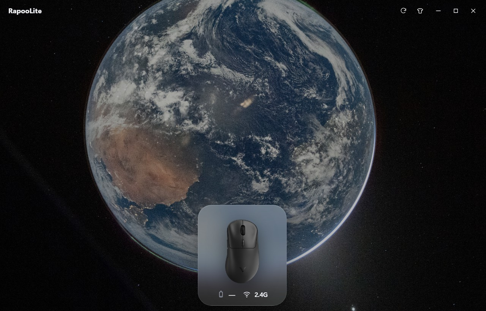
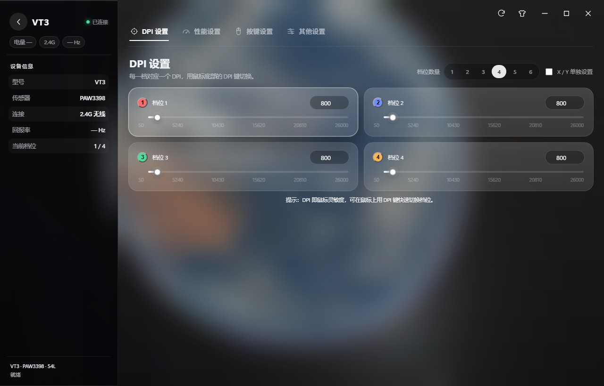
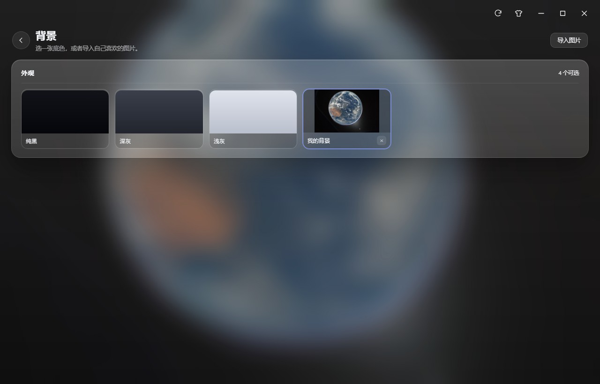

# RapooLite

雷柏 **VT3**（原相 PAW3398，54L 无线方案）的轻量第三方配置工具，用来替代官方 A Hub。

纯用户态实现：Native 宿主（C# + WebView2）负责窗口、托盘、开机自启与卸载，Node 进程通过 node-hid 直接读写 HID 配置寄存器，界面是本地网页（深色玻璃风格，支持纯黑 / 深灰 / 浅灰 / 自选图片背景）。



> **下载**：到 [Releases](https://github.com/ClukayN/rapoolite-vt3-hub/releases) 下载 `RapooLite-Setup.msi` 双击安装即可。


## 快速开始

**方式一：MSI 安装包（推荐）**

```
dist\RapooLite-Setup.msi
```

双击安装即可，装完会：

- 把程序装到 `%LOCALAPPDATA%\Programs\RapooLite`（当前用户，不需要管理员）
- 在开始菜单创建「RapooLite」快捷方式
- 在「设置 → 应用 → 已安装的应用」里登记 **RapooLite**，可以直接卸载
- 卸载时清掉程序文件、快捷方式与开机自启项，**保留 `data\` 里的背景与设置**

卸载有三个入口，效果一致：

| 入口 | 位置 |
| --- | --- |
| 应用和功能 | 设置 → 应用 → 已安装的应用 → RapooLite → 卸载 |
| 应用内 | 界面「其他设置 → 应用」里的红色「卸载 RapooLite」文字 |
| 托盘 | 右键托盘图标 →「卸载 RapooLite…」 |

重新构建安装包：

```powershell
powershell -ExecutionPolicy Bypass -File installer\build-msi.ps1
```

内部用 WiX 3.14 的 `heat` / `candle` / `light`，产物会自动用 `host\sign.ps1` 的同一张自签名证书签名。

**方式二：免安装部署**

```powershell
powershell -ExecutionPolicy Bypass -File install.ps1
```

会把 `dist\` 复制到 `%LOCALAPPDATA%\Programs\RapooLite`、接好开机自启、创建开始菜单快捷方式并启动（不写卸载信息）。

> 为什么不在 `D:\dshWorkspace` 里直接双击：那个目录带沙盒 ACL（`Everyone` 拒绝删除子项 + 额外的沙盒 SID），
> 从这里启动的进程 **Windows 不会给它登记托盘图标**，写启动项也常被拒。装到用户目录后两个问题都消失。

**日常使用：双击开始菜单里的「RapooLite」**（无控制台窗口）。

| 方式 | 说明 |
| --- | --- |
| `dist\RapooLite-Setup.msi` | 安装包：装到用户目录 + 注册卸载信息（推荐） |
| `install.ps1` | 免安装部署：复制到用户目录并启动，不写卸载信息 |
| `dist\RapooLite.exe` | 最终成品：无边框窗口 + 托盘 + 开机自启，双击即用 |
| `start.cmd` | 优先启动上面的 exe；没有构建过则回退到 Node 模式 |
| `node start.js` | 开发用：起后端 + 托盘 + Edge `--app` 窗口 |
| `node start.js --no-open` | 只起后端，自己用浏览器打开 `http://127.0.0.1:7373` |
| `node start.js --silent` | 静默启动（只有托盘，不弹窗口） |
| `node test-smoke.js` | 协议冒烟测试：连设备 → 全量读 → 逐项校验 |

## 界面

主页是纯展示页：背景占满整窗，下缘一块圆角玻璃卡片，上半是 VT3 实物图（抠掉白底），下半是电量与连接方式。**点卡片进入鼠标设置**（DPI / 性能 / 按键 / 其他四页），左上角圆形按钮回主页；顶栏 T 恤按钮进入「背景」页，可换纯色或自选图片（多张预设，可增删）。

| 设置页 | 背景页 |
| --- | --- |
|  |  |

## 构建 exe

需要 .NET Framework 4.8 自带的 `csc.exe`（Windows 10/11 自带）和 Node.js 18+：

```powershell
powershell -ExecutionPolicy Bypass -File host\build.ps1
```

产物在 `dist\`：`RapooLite.exe`（约 58 KB，宿主）+ `app\`（Node 后端与界面，约 21 MB）+ WebView2 DLL。
WebView2 程序集直接从本机已装组件复制，不联网；运行时需要系统里的 **WebView2 Runtime**（Win11 自带，Win10 一般随 Edge 装好）。

## 代码签名（消除「无法验证发布者」）

```powershell
powershell -ExecutionPolicy Bypass -File host\sign.ps1 -Exe dist\RapooLite.exe
```

用 `CN=RapooLite Local Dev` 的自签名证书签名，并把证书装进当前用户的「受信任的根证书颁发机构」+「受信任的发布者」（装根证书时会弹一次系统确认框，点「是」）。
只对本机当前用户有效；撤销：`certmgr.msc` 里删掉这张证书。

## 功能

| 功能 | 说明 |
| --- | --- |
| 设备状态 | 型号、连接方式、回报率、当前档位、电量（被动广播包） |
| 灵敏度 | 最多 6 档 DPI，50–26000，可 X/Y 分开设置，可直接切换当前档 |
| 回报率 | 125 / 250 / 500 / 1000 / 2000 / 4000 / 8000 Hz（切换后重新初始化无线链路） |
| 性能模式 | 低功耗 / 高性能 / 竞技 / 超频（可用项随回报率变化） |
| 按键扫描率 | 1000 / 2000 / 4000 / 8000 Hz |
| 按键映射 | 8 个物理键（左 / 右 / 中 / 前进 / 后退 / DPI+ / DPI− / 底部 DIY）→ 鼠标键、DPI 加减档、键盘键、多媒体键、系统组合键、禁用 |
| 传感器 | 静默高度 LOD、去抖时间、抬起延迟 |
| 轨迹优化 | 移动同步、直线修正、波纹控制、玻璃模式 |
| 电源与无线 | 休眠时间、无线策略（省电 / 全速）、低电量指示灯 |
| 样式 | 背景页：纯黑 / 深灰 / 浅灰 / 自选图片（多预设，可增删） |
| 托盘 | 电池图标显示电量（>50% 白 / 20–50% 橙 / <20% 红），悬停显示电量·DPI·回报率，左键唤出界面，右键菜单 |
| 档位提示 | 按鼠标上的 DPI 键切换档位时，屏幕右下角弹迷你提示 |
| 开机自启 | 写当前用户启动项，静默启动到托盘 |
| 卸载 | 应用内按钮 / 托盘菜单 / 应用和功能，三处入口一致 |

## 档位提示（屏幕右下角）

鼠标自己按 DPI+ / DPI− 切换档位时，宿主通过 SSE 收到状态变化，在屏幕右下角弹一张黑色圆角卡片（1200 / 第 4 档 / 4），淡入 → 停留 1.7 秒 → 淡出。

## 托盘与开机自启


- 图标按电量变色，鼠标悬停显示 `RapooLite · VT3 · 86% · 1000DPI 1000Hz`
- 左键单击唤出界面；右键菜单：打开界面 / 重新读取 / 开机自启 / 卸载 RapooLite… / 退出
- 关窗口不退出，留在托盘；退出请用托盘菜单「退出」
- 开机自启写在 `HKCU\Software\Microsoft\Windows\CurrentVersion\Run`，值为 `"<安装目录>\RapooLite.exe" --silent`（不需要管理员）
- 启动时自检：启动项指向的文件不存在会自动按当前位置重写；托盘图标被系统丢掉会在 45 秒内自动重新注册

## 目录结构

```text
RapooLite/
├── ui/                 界面（index.html / styles.css / app.js / assets）
├── lib/                协议与业务层
│   ├── protocol.js       寄存器表、编码、DPI 表
│   ├── hid.js            HID 读写（串行队列 + 12ms 节拍 + 休眠重试）
│   ├── device.js         状态机、全量读取、各 setter
│   └── autostart.js      开机自启（注册表 / 启动文件夹 / 自愈）
├── host/               原生宿主（C#）
│   ├── Program.cs        窗口、托盘、OSD、窗控、单实例、卸载器
│   ├── app.manifest      Per-Monitor V2 DPI 声明
│   ├── app.ico / make-icon.ps1
│   ├── build.ps1 / sign.ps1
│   └── lib/              WebView2 三个 DLL
├── installer/          MSI 打包
│   ├── product.wxs       WiX 源（perUser、开始菜单、卸载清理、运行目录清理）
│   └── build-msi.ps1     heat → candle → light → 签名
├── server.js           本地 HTTP + SSE + 主题 API
├── start.js            启动器（Node 模式）
├── install.ps1         免安装部署脚本
├── test-smoke.js       协议冒烟测试
├── docs/               截图
└── dist/               构建产物（RapooLite.exe / app / RapooLite-Setup.msi）
```

## 协议要点（自测得出的硬事实）

- 写命令 `A5 A5 <len> <addr> <bank> 00 00 <data…>` 走 **output report 6**；读命令 `A5 A4 <len> <addr> <bank> 00 00 00` 同样走 report 6，然后从 **feature report 8** 读回 `01 00 00 00 <值…>`
- 写和读在**两个不同的 HID 集合**：写走 usagePage `0xFF00` / usage `0x0E`，读走 `0xFF00` / `0x0F`
- `getFeatureReport(8, 32)` 会报 `ERROR_INVALID_PARAMETER`，必须传 **33**
- 命令间隔 12ms；切换回报率后等 120ms；DPI 写入顺序：表 X → 表 Y → 档位数 → 当前档
- 电量与档位变化是**被动广播包**（隐藏集合 `0xFF00` / usage `0x02`，report id 7），主动读不到
- 性能模式的寄存器地址跟着回报率变（1000Hz → `0xDF`，2000Hz → `0xE0`…），回报率一变必须整体重读

## 已知限制

- 只支持 54L 这一代（VID `0x24AE` / PID `0x1412`），其它型号的地址表不同
- 不含官方那些云端功能：宏录制、灯效（VT3 无灯）、配置文件云端同步、固件升级
- 与官方 A Hub 同时运行会互相覆盖设置，建议只开一个
- 设备休眠时读不到参数（会显示「—」），动一下鼠标自动恢复
- 界面窗口依赖 WebView2 Runtime；托盘菜单依赖 .NET Framework 4.8（Win10/11 自带）
- 高 DPI 屏：已声明 Per-Monitor V2，按物理像素渲染，跨屏拖动会重新适配
- 自签名证书只对本机当前用户有效，换机器会重新弹「无法验证发布者」

## 免责声明

第三方工具，与雷柏官方无关。所有写入都只碰配置寄存器（不碰固件），每次写入后回读校验；但仍建议自行承担风险，重要配置请留意记录。
